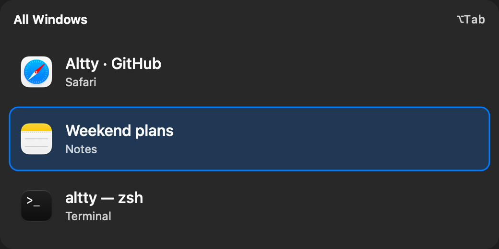
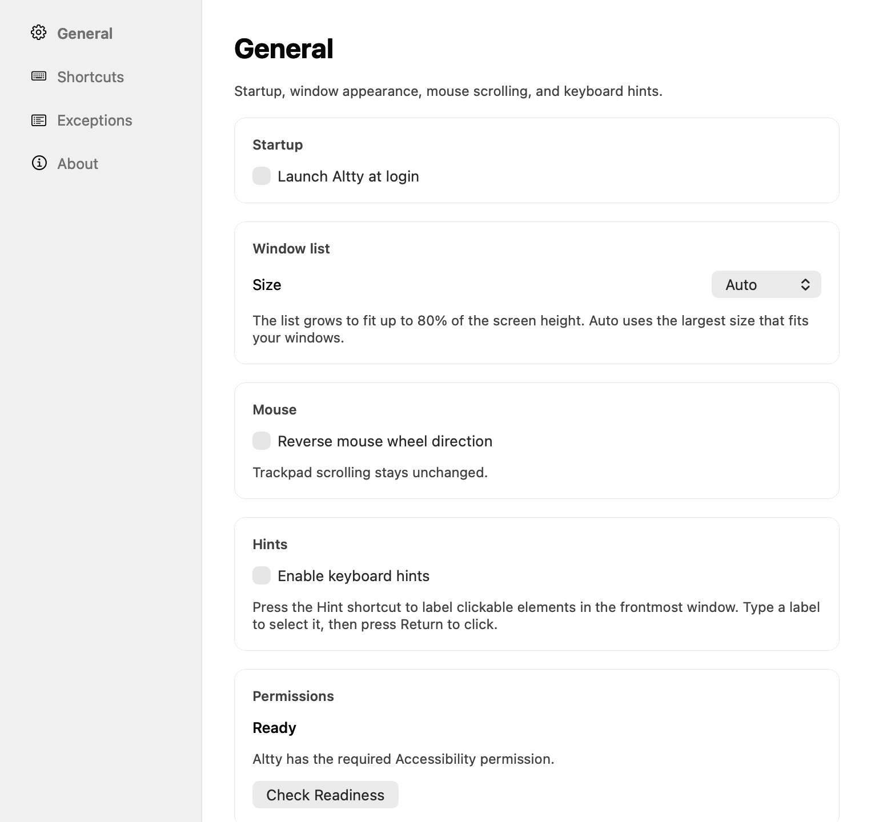

# Altty

A lightweight window switcher for macOS. Switch windows, move and click the
pointer with your keyboard, and control mouse scrolling from a native menu bar app.

**Apple Silicon · macOS 15 or later**

<p align="center">
  
</p>

<p align="center"><sub>Window switching with sample windows.</sub></p>

## Features

- **Switch windows.** Press **⌥ Tab** to switch between windows on your current
  Space, or **⌥ `** to switch between windows of the current app. Customize both
  shortcuts in Settings.
- **Keep the list readable.** Choose a compact or larger window list, or let Auto
  adjust the size to fit your screen.
- **Set app exceptions.** Hide selected apps from the list or let them receive
  shortcuts directly. Remote desktop and virtual machine apps have sensible
  defaults for fullscreen use.
- **Click with your keyboard.** Optional keyboard hints label clickable elements
  in the frontmost app. Type a label to select an element, then press Return.
- **Control the pointer.** Toggle Mouse Mode to move with **WASD**, hold **U** to
  slow down or **I** to speed up, and click with **J / K**. Press **F** to jump to
  a hint target. Altty's menu bar icon turns blue while Mouse Mode is active.
- **Reverse only your mouse wheel.** Keep your trackpad's scrolling direction
  while reversing mouse scrolling.

Altty lives in the menu bar and does not require Screen Recording permission.

## Install

Install with [Homebrew](https://brew.sh):

```sh
brew install --cask txchen/tap/altty
open /Applications/Altty.app
```

You can also download the ZIP from [Releases](https://github.com/txchen/altty/releases),
unzip it, and move **Altty.app** to **Applications**.

Release builds are signed with Developer ID and notarized by Apple. Intel Macs
are not supported.

## First launch

Grant **Accessibility** access when Altty asks, then try **⌥ Tab**. If macOS asks
you to restart Altty after granting permission, quit and reopen it.

Open Settings from the menu bar to change shortcuts and exceptions. Keyboard
hints, Mouse Mode, and mouse wheel reversal are off by default. Mouse wheel
reversal also
requires **Input Monitoring** permission. Quit other mouse scroll reversal apps
before enabling it.

See the [usage guide](Docs/usage.md) for keyboard controls, permissions, and
app compatibility notes.

<p align="center">
  
</p>

## Mouse Mode

Enable **Mouse Mode** in Settings → General, then record **Toggle Mouse Mode**
in Settings → Shortcuts. Press that shortcut to enter or exit the mode.

| Key | Action |
| --- | --- |
| Hold W / A / S / D | Move up / left / down / right |
| Hold U / I | Slow down / speed up |
| J / K | Left click / right click |
| F, then a hint label | Move to a clickable element without clicking |
| Esc | Return from hints, or exit Mouse Mode |

The front card of Altty's menu bar icon turns blue while the mode is active.
Clicks keep the mode active; movement stops when you release the keys. No
floating instruction panel covers your windows. Dragging and keyboard scrolling
are not included in this version.

## Update or uninstall

Quit Altty before updating, then reopen it:

```sh
brew update
brew upgrade --cask altty
open /Applications/Altty.app
```

Uninstall while keeping your settings:

```sh
brew uninstall --cask altty
```

To remove saved settings too, use `brew uninstall --zap --cask altty` instead.

## Development

See the [development guide](Docs/development.md) for local builds, tests, signing,
and the release workflow. Report problems through [GitHub Issues](https://github.com/txchen/altty/issues).
